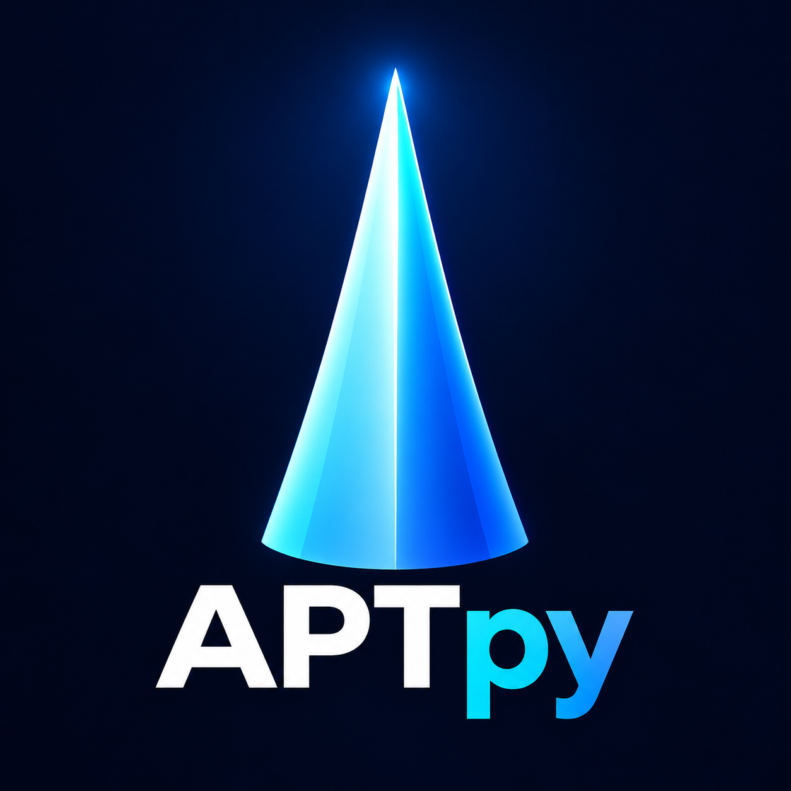

# APTpy



**A graphical Python toolbox for atom-probe tomography data analysis.**

APTpy brings candidate-ion exploration, mass-spectrum ranging, and isotope-overlap
analysis into a common desktop interface. The project aims to make APT analysis
more accessible and systematic, with graphical tools that help researchers inspect
their data, record their decisions, and export results without writing analysis
code for routine tasks.

The integrated application is **APTpy V1.0.0**. This version number belongs to the
main toolbox; individual modules can have their own version numbers.

## Tools included

| Tool | Purpose |
| --- | --- |
| Candidate List Maker / Spectrum Analyser | Explore atomic and molecular ions, isotope fingerprints, experimental spectra, and candidate assignments. |
| Range File Maker | Create and edit integration ranges, select candidate assignments, and export range files. |
| Isotope Deconvolution | Fit isotope-constrained mixtures across ranges, inspect overlapping candidates, and export analysis and composition tables. |

The candidate workflow originated in a literature review of Fe–C–Mn–Al–Si-based
alloys and related advanced high-strength steels. Candidate lists support
interpretation; a calculated mass position alone does not establish an ion identity.

## Workflow

```text
EPOS data
    → candidate exploration and isotope fingerprints
    → spectrum overlay and candidate review
    → range definition and assignment
    → isotope-overlap analysis
    → candidate, range, and analysis exports
```

The tools exchange project JSON files that preserve spectrum information,
candidate selections, and range definitions. Save your project and keep any
associated backups alongside it. Consult [the user guide](docs/USER_GUIDE.md)
before interpreting shared ranges or fitted compositions.

## Relationship to APAV

APTpy is an independent companion project built on
[APAV](https://gitlab.com/jesseds/apav), and is not an official APAV interface.
Its motivation follows the APAV FAQ discussion of a GUI existing alongside APAV
as a Python library. APAV supports EPOS handling and isotope calculations used in
this toolbox; APTpy adds graphical workflows and its own analysis logic.

The isotope-overlap model is custom APTpy code using APAV and SciPy. It is not an
APAV built-in algorithm. Please acknowledge and cite APAV separately when used.

## Getting started

### Main macOS application

The prepared distribution contains `APTpy V1.0.0.app`. Download the ZIP from the
repository's Releases page once a release is published, extract it, and open the app.

**Current distribution requirements:**

- Apple Silicon Mac: the supplied native executable is `arm64`.
- macOS 12 or later is declared in the app metadata; a clean-machine compatibility
  test has not been performed for this repository preparation.
- An external Python installation with the required packages. Python is not
  bundled in the supplied app.

The supplied launcher currently expects `/opt/anaconda3/bin/python3` for the
candidate and range modules and `/opt/anaconda3/envs/xrd_env/bin/python` for isotope
analysis. Consequently, the app is not yet a portable, self-contained installer.
See [installation notes](docs/INSTALLATION.md) for source-based use and known limits.

### Python source

The available Python, notebook, HTML, and template resources are in `source/`.
The two web modules use macOS file dialogs. Source-based use has not been verified
on Windows or Linux.

```bash
python3 -m venv .venv
source .venv/bin/activate
python -m pip install -r requirements.txt
```

Start the candidate interface:

```bash
JUPYTER_PATH="$PWD/source/candidate/jupyter" python -m voila "source/candidate/1- APTpy-Spectrum Analyser-V1.0.2.ipynb"
```

Start the range editor or isotope interface in a separate terminal:

```bash
python source/ranges/server.py
```

```bash
python source/isotope/server.py
```

These commands launch the individual interfaces, not the integrated native window.
The native launcher source was not present in the supplied app bundle and is not
included here; the native executable cannot currently be rebuilt from this folder.

## Example projects

Two [example project snapshots from dataset 865](examples/865/README.md) are
included: a candidate-stage project and a ranged project with 51 integration
ranges. Both contain a cached experimental mass spectrum and 26 selected ions.
Raw EPOS data are not included. Copy an example to a working folder before editing.

## Repository layout

```text
source/           Python, notebook, HTML, and template resources copied from the app
assets/           Project logo
examples/865/     Candidate-stage and ranged example project JSON files
docs/             Installation, usage, and publishing notes
distribution/     Local app and release ZIP; excluded from Git tracking
README.md         Project overview
LICENSE           GNU GPL version 3 license text
CITATION.cff      Toolbox citation metadata
requirements.txt Direct Python dependencies; not a locked environment
CHANGELOG.md      Integrated toolbox release history
CONTRIBUTING.md   Reporting issues and contributing
THIRD_PARTY.md    Attribution and dependency notes
```

## Scientific limitations

Review candidate identities, integration boundaries, and isotope patterns against
the experimental spectrum and relevant literature. Overlapping peaks can have
multiple plausible explanations.

Isotope fitting assumes the selected species, fixed isotope fingerprints, and the
model's capture-efficiency and background assumptions. Results are conditional on
those choices. Cached histogram counts are approximate at integration boundaries;
event-level EPOS counts should be preferred when available. The method does not
identify individual detected events.

RRNG can preserve unresolved shared ranges. RNG export requires a resolved
composition for every exported range. Compatibility with every commercial APT
software version has not been established.

## Acknowledgment and citation

If APTpy contributes to your research, please cite the specific toolbox release
used and acknowledge its developer, **Roohallah Surki Aliabad**.

Suggested acknowledgment:

> The authors acknowledge Roohallah Surki Aliabad for developing APTpy, a graphical
> Python toolbox for candidate-ion exploration, range-file creation, and
> isotope-overlap analysis in atom-probe tomography, built on APAV.

Until a DOI is assigned to the integrated toolbox, a repository citation can use:

> Aliabad, R. S. (2026). *APTpy* (Version 1.0.0) [Computer software].
> GitHub. <https://github.com/APTpy/APTpy>. Include the access date.

The earlier, separately archived **Spectrum Analyser v1.0.1** is available at
[doi:10.5281/zenodo.23296361](https://doi.org/10.5281/zenodo.23296361).
That DOI refers to the earlier component, not this integrated toolbox release.

Please also cite APAV:

> Smith, J. D., & Young, M. L. (2023). APAV: An Open-Source Python Package for Mass
> Spectrum Analysis in Atom Probe Tomography. *Journal of Open Source Software*,
> 8(83), 4862. <https://doi.org/10.21105/joss.04862>

## License

APTpy's own contributions are distributed under the **GNU General Public License
version 3 or later (GPL-3.0-or-later)**. See [LICENSE](LICENSE).
Copyright © 2026 Roohallah Surki Aliabad.

Third-party dependencies and resources retain their respective licenses and
notices; see [THIRD_PARTY.md](THIRD_PARTY.md). Citation requests above are scholarly
requests and do not add restrictions to the GPL.

## Feedback and development

Feedback, reproducible bug reports, and contributions are welcome. Please describe
the module, app version, operating system, and steps that produced the issue.
See [CONTRIBUTING.md](CONTRIBUTING.md).

Future development aims include portable installation, a reproducible native
build, broader validation, and additional tools under the APTpy umbrella.
